

# 🌸 ANN vs RNN on Iris: Neural Networks from First Principles

**Two neural networks written from scratch in NumPy: hand-derived backpropagation, backpropagation-through-time
and Adam, verified against finite differences, compared with honest statistics and opened up with 14 mathematical visualisations.**

 -1baf7a)  

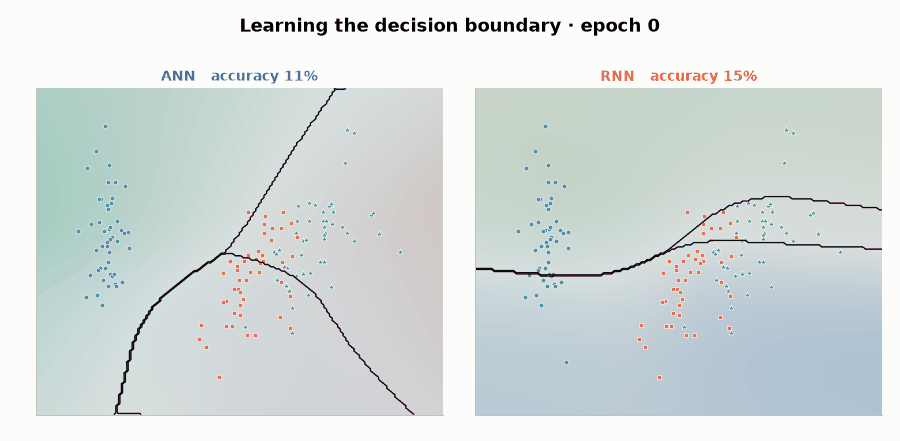

> **© 2026 Husain Naqvi. All rights reserved.** This is a portfolio showcase. Copying, re-uploading or reusing any part of this work without written permission is prohibited — see [LICENSE](LICENSE).

---

## Why this project

Iris is the "hello world" of machine learning, and that is exactly why it is useful here: with the data problem solved,
all the attention can go to **how the networks work**. Instead of calling `model.fit()`, every equation is
derived, implemented, tested and visualised:

| | What is done | Why it matters |
|---|---|---|
| 🧮 | Forward pass, backprop, **BPTT** and **Adam** written by hand in NumPy | Shows understanding of the calculus, not just the API |
| ✅ | Every gradient **checked against finite differences** (median relative error ~10⁻⁹, max < 10⁻⁵) | Proves the derivation is correct |
| 📊 | **5-fold × 3-repeat** stratified CV + **Nadeau–Bengio corrected t-test** + Wilcoxon | An honest answer to "is model A better than B?" |
| 🔬 | Loss landscapes, eigen-spectra, hidden-state trajectories, calibration, gradient flow | Looks *inside* the models, not just at accuracy |
| 🧪 | Inductive-bias experiments: all **24 feature orderings**, sample-efficiency curves | Asks *why*, not only *how well* |
| 🌐 | **Live Streamlit app** + interactive Plotly page | Anyone can explore it in one click |

## Key results

| Model | Accuracy | Macro-F1 | Log-loss | Parameters |
|---|---|---|---|---|
| **ANN** (4 → 16 tanh → 3) | **0.960 ± 0.036** | 0.960 ± 0.036 | **0.158 ± 0.168** | 131 |
| **RNN** (Elman, H = 10, T = 4) | 0.956 ± 0.041 | 0.955 ± 0.042 | 0.219 ± 0.178 | 153 |

Mean ± s.d. over 15 test folds (5-fold × 3-repeat stratified CV). Out-of-fold ROC-AUC ≥ 0.98 for every class, both models.

**Findings**

1. **No significant difference in accuracy.** Δ = +0.004 (95% CI −0.046 … +0.055), corrected *t* = 0.19, *p* = 0.85; Wilcoxon *p* = 0.98.
   On 150 samples, claims that one model "beats" the other are usually noise, and the statistics show it.
2. **The ANN is better calibrated** (lower log-loss; expected calibration error 0.030 vs 0.033).
3. **The RNN has the wrong inductive bias for tabular data.** It treats the 4 measurements as a time series, so the
   *reading order* changes its accuracy from **92.7 % to 96.7 %** across the 4! = 24 permutations. The ANN is order-invariant by construction.
4. **The ANN is far more sample-efficient**: with only 9 training flowers it reaches **89 %** vs **75 %** for the RNN.
5. **Inside the RNN**, training pushes the spectral radius of Whh above 1. With only T = 4 steps this does not explode,
   and each species follows its own trajectory through the 10-dimensional hidden-state space.

> **Take-away:** an RNN *can* solve a tabular problem, but its sequential prior adds parameters, order-sensitivity and data
> hunger without adding accuracy. Architecture should follow the structure of the data.

## Gallery

<table>
<tr>
<td width="50%">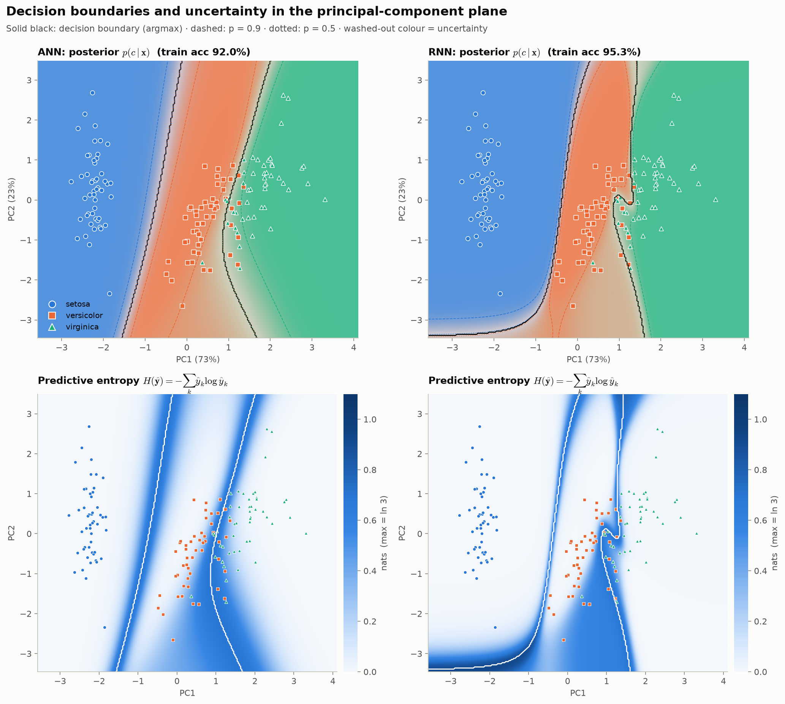 <b>Decision boundaries & predictive entropy</b>: posterior p(c|x) and H(ŷ) in the PCA plane.</td>
<td width="50%">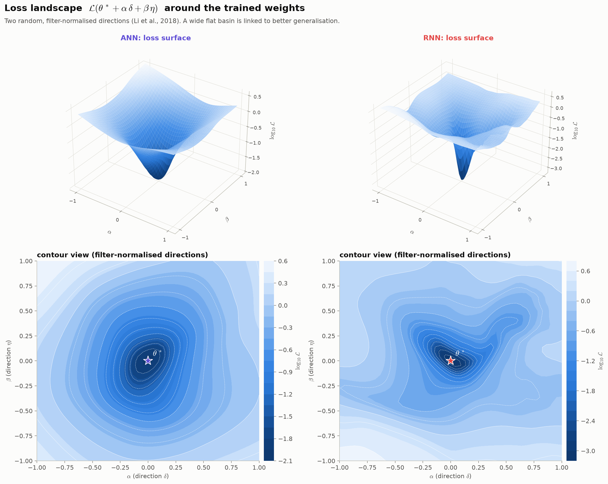 <b>Loss landscapes</b>: L(θ* + αδ + βη) along filter-normalised directions.</td>
</tr>
<tr>
<td>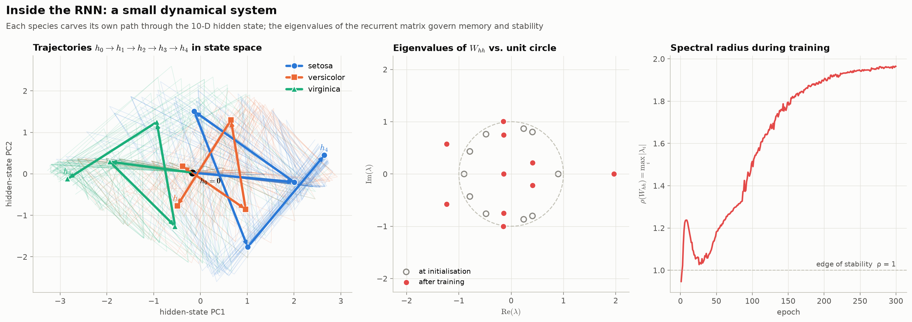 <b>RNN as a dynamical system</b>: state trajectories, eigenvalues of Whh, spectral radius.</td>
<td>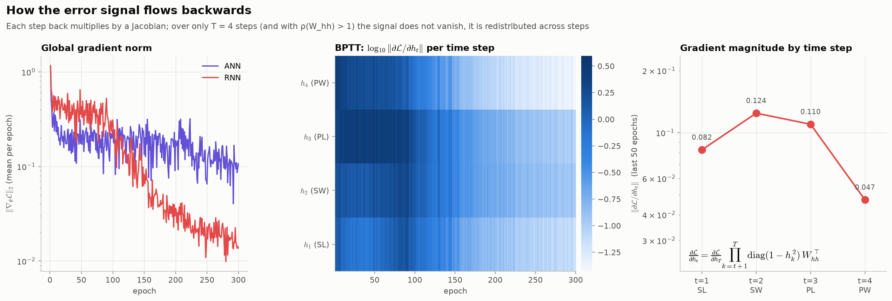 <b>Backpropagation through time</b>: ‖∂L/∂ht‖ per time step during training.</td>
</tr>
<tr>
<td>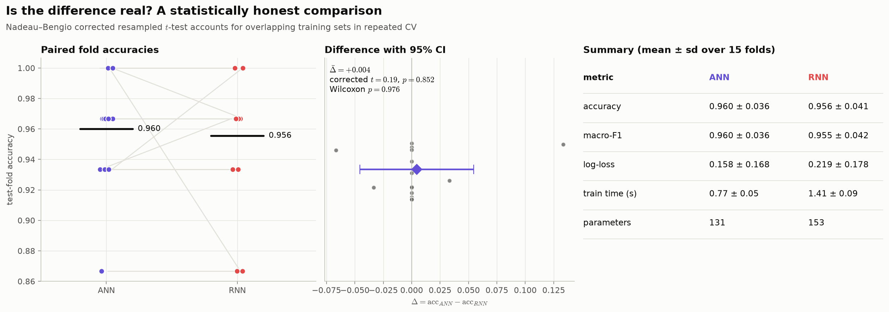 <b>Statistical comparison</b>: paired folds, corrected t-test, 95 % CI.</td>
<td>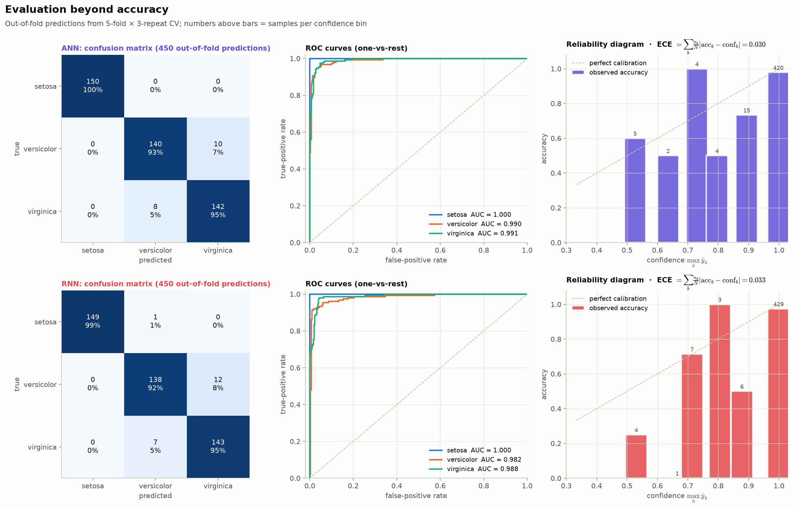 <b>Beyond accuracy</b>: confusion matrices, ROC curves, reliability diagrams.</td>
</tr>
<tr>
<td>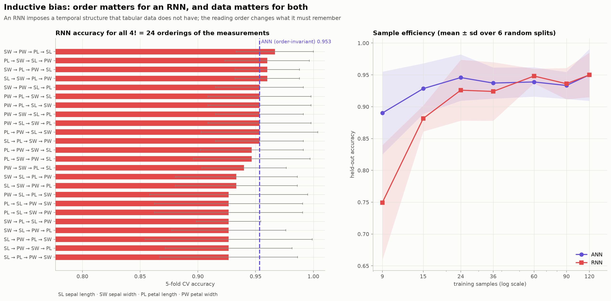 <b>Inductive bias</b>: all 24 reading orders and sample-efficiency curves.</td>
<td>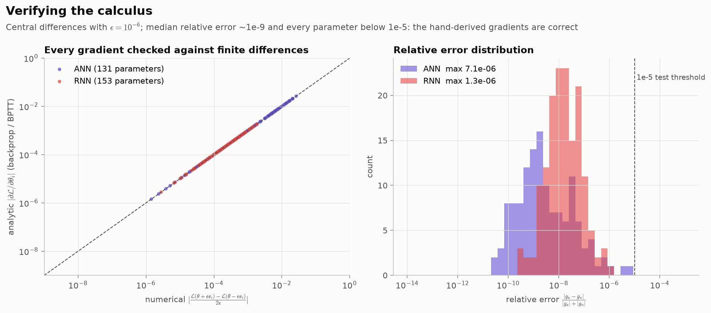 <b>Verifying the calculus</b>: analytic vs numerical gradients for every parameter.</td>
</tr>
<tr>
<td>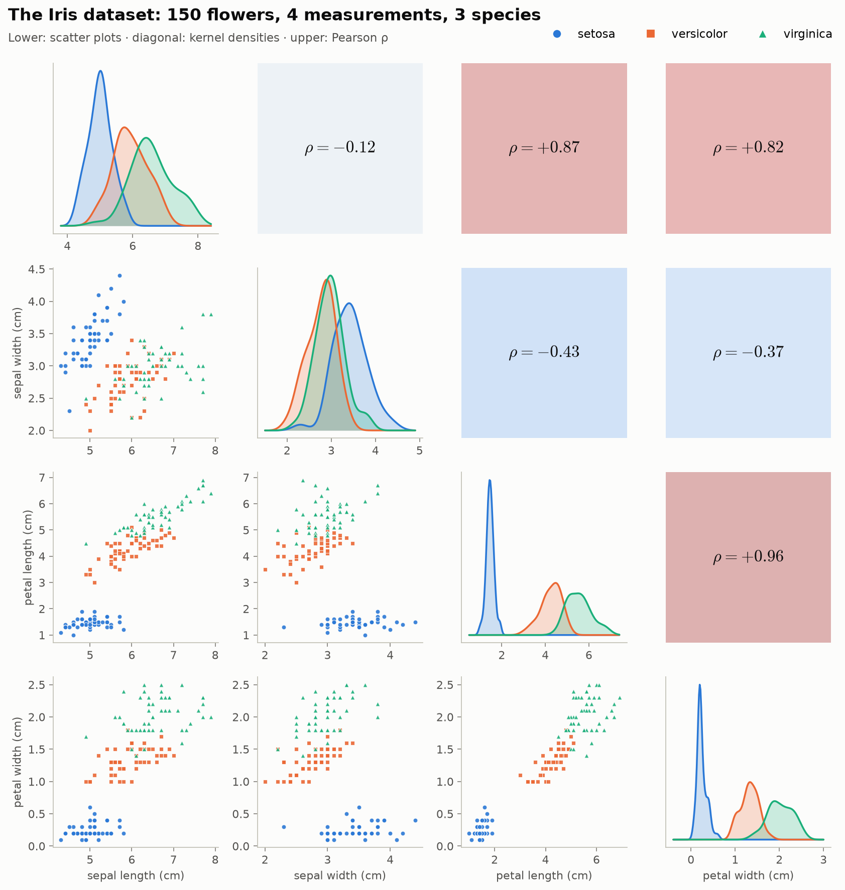 <b>The data</b>: scatter matrix, class densities, correlations.</td>
<td>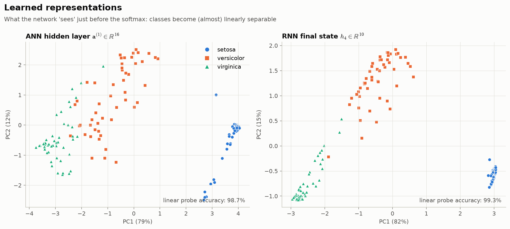 <b>Learned representations</b>: what each network "sees" before the softmax.</td>
</tr>
</table>

More: [architectures](docs/figures/03_architectures.png) · [PCA/LDA & eigen-spectrum](docs/figures/02_dataset_projections.png) ·
[learning curves](docs/figures/04_learning_curves.png) · [weight matrices](docs/figures/11_weights.png) ·
interactive [3-D loss surfaces](https://engr-husainnaqvi.github.io/ANN-vs-RNN-Iris/interactive/loss_landscape.html) and
[RNN trajectories](https://engr-husainnaqvi.github.io/ANN-vs-RNN-Iris/interactive/rnn_trajectories.html).

## The mathematics

<b>ANN: multilayer perceptron</b>

Forward pass for a mini-batch $X \in \mathbb{R}^{N\times 4}$:

$$
A^{(1)} = \tanh\left(XW^{(1)} + \mathbf{b}^{(1)}\right), \qquad
\hat{Y} = \mathrm{softmax}\left(A^{(1)}W^{(2)} + \mathbf{b}^{(2)}\right)
$$

Cross-entropy loss with L2 penalty, and the softmax + cross-entropy gradient that makes backprop clean:

$$
\mathcal{L} = -\frac{1}{N}\sum_{i=1}^{N}\sum_{k=1}^{3} y_{ik}\log\hat{y}_{ik} + \frac{\lambda}{2}\sum_{l}\lVert W^{(l)}\rVert_F^2,
\qquad
\frac{\partial\mathcal{L}}{\partial Z^{(2)}} = \frac{1}{N}\left(\hat{Y} - Y\right)
$$

Backward pass (chain rule, $\odot$ = element-wise product):

$$
\delta^{(2)} = \tfrac{1}{N}(\hat{Y}-Y),\quad
\frac{\partial\mathcal{L}}{\partial W^{(2)}} = A^{(1)\top}\delta^{(2)},\quad
\delta^{(1)} = \delta^{(2)}W^{(2)\top}\odot\left(1-A^{(1)}\odot A^{(1)}\right),\quad
\frac{\partial\mathcal{L}}{\partial W^{(1)}} = X^{\top}\delta^{(1)}
$$

<b>RNN: Elman network and backpropagation through time</b>

The four measurements are read as a sequence $x_1,\dots,x_4$ (one scalar per step):

$$
h_0 = \mathbf{0},\qquad h_t = \tanh\left(x_t W_{xh} + h_{t-1}W_{hh} + b_h\right),\qquad \hat{\mathbf{y}} = \mathrm{softmax}\left(h_4 W_{hy} + b_y\right)
$$

BPTT runs the chain rule backwards through time; the recurrent weights accumulate gradient from every step:

$$
\frac{\partial\mathcal{L}}{\partial h_{t-1}} = \left(\frac{\partial\mathcal{L}}{\partial h_t}\odot(1-h_t^2)\right)W_{hh}^{\top},
\qquad
\frac{\partial\mathcal{L}}{\partial W_{hh}} = \sum_{t=1}^{T} h_{t-1}^{\top}\left(\frac{\partial\mathcal{L}}{\partial h_t}\odot(1-h_t^2)\right)
$$

Unrolling gives the product of Jacobians behind vanishing and exploding gradients:

$$
\frac{\partial\mathcal{L}}{\partial h_t} = \frac{\partial\mathcal{L}}{\partial h_T}\prod_{k=t+1}^{T}\mathrm{diag}\left(1-h_k^2\right)W_{hh}^{\top},
\qquad
\left\lVert\frac{\partial h_T}{\partial h_t}\right\rVert \le \left(\gamma\,\sigma_{\max}(W_{hh})\right)^{T-t}
$$

<b>Adam, gradient checking, statistics, loss landscape, calibration</b>

**Adam** (with global-norm gradient clipping):
$m_t = \beta_1 m_{t-1} + (1-\beta_1)g_t,\; v_t = \beta_2 v_{t-1} + (1-\beta_2)g_t^2,\;
\theta_t = \theta_{t-1} - \eta\,\hat m_t/(\sqrt{\hat v_t}+\epsilon)$ with bias corrections $\hat m_t = m_t/(1-\beta_1^t)$, $\hat v_t = v_t/(1-\beta_2^t)$.

**Gradient check:** $\dfrac{\partial\mathcal{L}}{\partial\theta_i}\approx\dfrac{\mathcal{L}(\theta+\epsilon e_i)-\mathcal{L}(\theta-\epsilon e_i)}{2\epsilon}$,
relative error $\dfrac{|g_a-g_n|}{|g_a|+|g_n|}$, required to be below $10^{-5}$ in the test-suite.

**Corrected resampled t-test** (Nadeau & Bengio, 2003) for $J$ folds of repeated CV with $n_2/n_1$ test/train ratio:
$t = \bar{d}\,\big/\sqrt{\left(\tfrac{1}{J}+\tfrac{n_2}{n_1}\right)\hat\sigma_d^2}$, which corrects the over-confidence of the naive paired t-test.

**Loss landscape:** $f(\alpha,\beta) = \mathcal{L}(\theta^* + \alpha\delta + \beta\eta)$, with random directions normalised per neuron
to the norm of the corresponding weights (Li et al., 2018).

**Calibration:** $\mathrm{ECE} = \sum_b \tfrac{n_b}{N}\left|\mathrm{acc}_b - \mathrm{conf}_b\right|$; **predictive entropy** $H(\hat{\mathbf{y}}) = -\sum_k \hat y_k\log\hat y_k$.

## Source code and trained models

The full implementation (source package, experiment and figure scripts, unit tests, the
walkthrough notebook and the trained model weights) is kept in a **private repository**.
Access is available on request to professors, admissions committees, reviewers and
collaborators — contact me via [LinkedIn](https://www.linkedin.com/in/hafizhussain) or [GitHub](https://github.com/Engr-HusainNaqvi).

Everything you need to evaluate the work is public here: the results, every figure, the
[project page](https://engr-husainnaqvi.github.io/ANN-vs-RNN-Iris/), the interactive pages and the live demo.

## Experimental protocol

- **Data:** Fisher's Iris (150 samples, 4 features, 3 balanced classes). Features are z-scored with statistics from the **training split only**.
- **Models:** ANN 4 → 16 (tanh) → 3 (131 parameters); Elman RNN with H = 10 reading one measurement per step (153 parameters), so capacity is matched.
  Glorot initialisation; the RNN's recurrent matrix starts orthogonal with spectral radius 0.9.
- **Training:** Adam (η = 0.01), batch 16, 300 epochs, L2 λ = 10⁻⁴, global-norm clipping at 5.
- **Evaluation:** 5-fold × 3-repeat stratified CV (15 paired folds, same splits and seeds for both models); out-of-fold
  predictions for ROC, confusion and calibration analysis; an instrumented 80/20 hold-out run for the internal analyses.

## References

1. R. A. Fisher (1936). *The use of multiple measurements in taxonomic problems.* Annals of Eugenics 7(2).
2. D. E. Rumelhart, G. E. Hinton, R. J. Williams (1986). *Learning representations by back-propagating errors.* Nature 323.
3. J. L. Elman (1990). *Finding structure in time.* Cognitive Science 14(2).
4. Y. Bengio, P. Simard, P. Frasconi (1994). *Learning long-term dependencies with gradient descent is difficult.* IEEE TNN 5(2).
5. R. Pascanu, T. Mikolov, Y. Bengio (2013). *On the difficulty of training recurrent neural networks.* ICML.
6. D. P. Kingma, J. Ba (2015). *Adam: A method for stochastic optimization.* ICLR.
7. C. Nadeau, Y. Bengio (2003). *Inference for the generalization error.* Machine Learning 52.
8. H. Li, Z. Xu, G. Taylor, C. Studer, T. Goldstein (2018). *Visualizing the loss landscape of neural nets.* NeurIPS.
9. C. Guo, G. Pleiss, Y. Sun, K. Q. Weinberger (2017). *On calibration of modern neural networks.* ICML.

## Author

**Husain Naqvi**, Biomedical Engineer · AI for biomedical signals and medical imaging ·
[GitHub](https://github.com/Engr-HusainNaqvi) · [LinkedIn](https://www.linkedin.com/in/hafizhussain)

To cite this work, use [`CITATION.cff`](CITATION.cff). © 2026 Husain Naqvi. All rights reserved — see [LICENSE](LICENSE).
